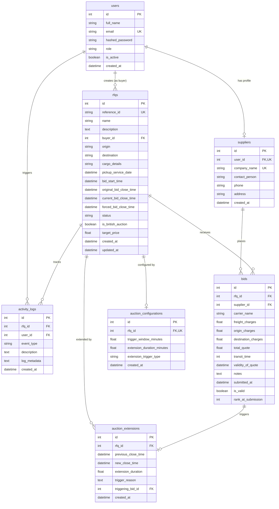

# Database Schema Design - British Auction RFQ Management System

## 1. Overview

The British Auction RFQ System database is implemented using **SQLite** with the **SQLAlchemy 2.0 ORM**. The schema is normalized into 7 core tables designed to track users, supplier profiles, procurement RFQs, British auction configurations, time extensions, submitted quotes, and audit logs.

---

## 2. Entity-Relationship (ER) Diagram

---

## 3. Database Table Definitions

### Table 1: `users`
Stores user credentials, access roles, and platform status.

| Column | Type | Constraints / Attributes | Description |
| :--- | :--- | :--- | :--- |
| `id` | `INTEGER` | `PRIMARY KEY, AUTOINCREMENT, INDEX` | Unique identifier for user account |
| `full_name` | `VARCHAR(255)` | `NOT NULL` | Full legal or display name |
| `email` | `VARCHAR(255)` | `NOT NULL, UNIQUE, INDEX` | Work email address used for login |
| `hashed_password` | `VARCHAR(255)` | `NOT NULL` | Secure salted bcrypt hash of user password |
| `role` | `VARCHAR(20)` | `NOT NULL, ENUM('ADMIN', 'BUYER', 'SUPPLIER')` | System role governing permission access |
| `is_active` | `BOOLEAN` | `NOT NULL, DEFAULT TRUE` | Active account toggle |
| `created_at` | `DATETIME` | `NOT NULL, DEFAULT UTC NOW` | Account creation timestamp |

- **SQLAlchemy Model**: [`User`](file:///d:/gocomet-rfq-auction/backend/app/models/user.py#L14)
- **Relationships**:
  - `supplier_profile`: One-to-One with `Supplier` (cascade: `all, delete-orphan`)
  - `rfqs`: One-to-Many with `RFQ` (cascade: `all, delete-orphan`)
  - `activity_logs`: One-to-Many with `ActivityLog`

---

### Table 2: `suppliers`
Stores company details and identity for registered logistics suppliers and carrier operators.

| Column | Type | Constraints / Attributes | Description |
| :--- | :--- | :--- | :--- |
| `id` | `INTEGER` | `PRIMARY KEY, AUTOINCREMENT, INDEX` | Unique supplier entity identifier |
| `user_id` | `INTEGER` | `NOT NULL, UNIQUE, FK -> users.id (ON DELETE CASCADE)` | Reference to authenticating User account |
| `company_name` | `VARCHAR(255)` | `NOT NULL, UNIQUE, INDEX` | Registered corporate name (e.g. A.P. Moller - Maersk) |
| `contact_person` | `VARCHAR(255)` | `NOT NULL` | Primary representative contact name |
| `phone` | `VARCHAR(50)` | `NULLABLE` | Contact telephone number |
| `address` | `VARCHAR(500)` | `NULLABLE` | Registered business address |
| `created_at` | `DATETIME` | `NOT NULL, DEFAULT UTC NOW` | Supplier registration timestamp |

- **SQLAlchemy Model**: [`Supplier`](file:///d:/gocomet-rfq-auction/backend/app/models/user.py#L31)
- **Relationships**:
  - `user`: Many-to-One with `User`
  - `bids`: One-to-Many with `Bid` (cascade: `all, delete-orphan`)

---

### Table 3: `rfqs`
Stores Request for Quotations (RFQs) created by buyers, logistics routes, and auction timelines.

| Column | Type | Constraints / Attributes | Description |
| :--- | :--- | :--- | :--- |
| `id` | `INTEGER` | `PRIMARY KEY, AUTOINCREMENT, INDEX` | Unique RFQ internal identifier |
| `reference_id` | `VARCHAR(50)` | `NOT NULL, UNIQUE, INDEX` | Human-readable identifier (e.g., `GC-RFQ-2026-001`) |
| `name` | `VARCHAR(255)` | `NOT NULL, INDEX` | Procurement title or route name |
| `description` | `TEXT` | `NULLABLE` | Detailed shipping cargo requirements |
| `buyer_id` | `INTEGER` | `NOT NULL, FK -> users.id (ON DELETE CASCADE)` | Reference to creating buyer user |
| `origin` | `VARCHAR(255)` | `NOT NULL` | Origin seaport / airport location |
| `destination` | `VARCHAR(255)` | `NOT NULL` | Destination seaport / airport location |
| `cargo_details` | `VARCHAR(255)` | `NULLABLE` | Packaging, container size, cargo weight |
| `pickup_service_date` | `DATETIME` | `NOT NULL` | Expected cargo dispatch / pickup date |
| `bid_start_time` | `DATETIME` | `NOT NULL` | Scheduled date and time bidding opens |
| `original_bid_close_time` | `DATETIME` | `NOT NULL` | Original scheduled closing time |
| `current_bid_close_time` | `DATETIME` | `NOT NULL, INDEX` | Effective closing time (dynamically extended) |
| `forced_bid_close_time` | `DATETIME` | `NOT NULL` | Absolute maximum close ceiling |
| `status` | `VARCHAR(20)` | `NOT NULL, ENUM('SCHEDULED', 'ACTIVE', 'CLOSED', 'FORCE_CLOSED')` | Current lifecycle state |
| `is_british_auction` | `BOOLEAN` | `NOT NULL, DEFAULT TRUE` | Enables British Auction anti-sniping rules |
| `target_price` | `FLOAT` | `NULLABLE` | Internal baseline benchmark price |
| `created_at` | `DATETIME` | `NOT NULL, DEFAULT UTC NOW` | Creation timestamp |
| `updated_at` | `DATETIME` | `NOT NULL, DEFAULT UTC NOW` | Last modification timestamp |

- **SQLAlchemy Model**: [`RFQ`](file:///d:/gocomet-rfq-auction/backend/app/models/rfq.py#L15)
- **Relationships**:
  - `buyer`: Many-to-One with `User`
  - `auction_config`: One-to-One with `AuctionConfiguration` (cascade: `all, delete-orphan`)
  - `bids`: One-to-Many with `Bid` (ordered by `total_quote.asc()`)
  - `extensions`: One-to-Many with `AuctionExtension` (ordered by `created_at.desc()`)
  - `activity_logs`: One-to-Many with `ActivityLog` (ordered by `created_at.desc()`)

---

### Table 4: `auction_configurations`
Stores British Auction parameters for each RFQ.

| Column | Type | Constraints / Attributes | Description |
| :--- | :--- | :--- | :--- |
| `id` | `INTEGER` | `PRIMARY KEY, AUTOINCREMENT, INDEX` | Unique configuration record identifier |
| `rfq_id` | `INTEGER` | `NOT NULL, UNIQUE, FK -> rfqs.id (ON DELETE CASCADE)` | Associated RFQ |
| `trigger_window_minutes` | `FLOAT` | `NOT NULL, DEFAULT 10.0` | **$X$ minutes**: Time window before close monitoring activity |
| `extension_duration_minutes` | `FLOAT` | `NOT NULL, DEFAULT 5.0` | **$Y$ minutes**: Duration added when trigger rule is met |
| `extension_trigger_type` | `VARCHAR(30)` | `NOT NULL, ENUM('ANY_BID', 'ANY_RANK_CHANGE', 'L1_RANK_CHANGE')` | Trigger rule: Option A, Option B, or Option C |
| `created_at` | `DATETIME` | `NOT NULL, DEFAULT UTC NOW` | Record creation timestamp |

- **SQLAlchemy Model**: [`AuctionConfiguration`](file:///d:/gocomet-rfq-auction/backend/app/models/auction.py#L14)
- **Relationships**:
  - `rfq`: One-to-One with `RFQ`

---

### Table 5: `auction_extensions`
Audit history of each dynamic extension triggered by competitive bids.

| Column | Type | Constraints / Attributes | Description |
| :--- | :--- | :--- | :--- |
| `id` | `INTEGER` | `PRIMARY KEY, AUTOINCREMENT, INDEX` | Unique extension event record identifier |
| `rfq_id` | `INTEGER` | `NOT NULL, INDEX, FK -> rfqs.id (ON DELETE CASCADE)` | Associated RFQ |
| `previous_close_time` | `DATETIME` | `NOT NULL` | Closing timestamp prior to extension |
| `new_close_time` | `DATETIME` | `NOT NULL` | New effective closing timestamp |
| `extension_duration` | `FLOAT` | `NOT NULL` | Minutes added by this extension event |
| `trigger_reason` | `TEXT` | `NOT NULL` | Detailed explanation of triggering condition and supplier |
| `triggering_bid_id` | `INTEGER` | `NULLABLE, FK -> bids.id (ON DELETE SET NULL)` | Reference to specific quote that triggered the extension |
| `created_at` | `DATETIME` | `NOT NULL, DEFAULT UTC NOW` | Timestamp when extension was calculated |

- **SQLAlchemy Model**: [`AuctionExtension`](file:///d:/gocomet-rfq-auction/backend/app/models/auction.py#L34)
- **Relationships**:
  - `rfq`: Many-to-One with `RFQ`
  - `triggering_bid`: Many-to-One with `Bid`

---

### Table 6: `bids`
Stores all quotes submitted by suppliers, including price itemization, operating carrier, transit time, and rankings.

| Column | Type | Constraints / Attributes | Description |
| :--- | :--- | :--- | :--- |
| `id` | `INTEGER` | `PRIMARY KEY, AUTOINCREMENT, INDEX` | Unique quote identifier |
| `rfq_id` | `INTEGER` | `NOT NULL, INDEX, FK -> rfqs.id (ON DELETE CASCADE)` | Target RFQ |
| `supplier_id` | `INTEGER` | `NOT NULL, INDEX, FK -> suppliers.id (ON DELETE CASCADE)` | Submitting supplier account entity |
| `carrier_name` | `VARCHAR(255)` | `NOT NULL` | Operating ocean carrier or airline fleet |
| `freight_charges` | `FLOAT` | `NOT NULL` | Base freight transportation price |
| `origin_charges` | `FLOAT` | `NOT NULL, DEFAULT 0.0` | Origin port terminal handling charges (THC) |
| `destination_charges` | `FLOAT` | `NOT NULL, DEFAULT 0.0` | Destination port and discharge charges |
| `total_quote` | `FLOAT` | `NOT NULL, INDEX` | Calculated total: `freight + origin + destination` |
| `transit_time` | `INTEGER` | `NOT NULL` | Estimated transit duration in days |
| `validity_of_quote` | `DATETIME` | `NOT NULL` | Expiration date of the submitted rate |
| `notes` | `TEXT` | `NULLABLE` | Demurrage terms, service guarantees, or vessel details |
| `submitted_at` | `DATETIME` | `NOT NULL, INDEX, DEFAULT UTC NOW` | Precise submission timestamp |
| `is_valid` | `BOOLEAN` | `NOT NULL, DEFAULT TRUE` | Active/valid status flag |
| `rank_at_submission` | `INTEGER` | `NULLABLE` | Rank achieved at the moment of submission |

- **SQLAlchemy Model**: [`Bid`](file:///d:/gocomet-rfq-auction/backend/app/models/bid.py#L7)
- **Relationships**:
  - `rfq`: Many-to-One with `RFQ`
  - `supplier`: Many-to-One with `Supplier`

---

### Table 7: `activity_logs`
Chronological audit trail of all procurement, bidding, extension, and system events.

| Column | Type | Constraints / Attributes | Description |
| :--- | :--- | :--- | :--- |
| `id` | `INTEGER` | `PRIMARY KEY, AUTOINCREMENT, INDEX` | Unique log entry identifier |
| `rfq_id` | `INTEGER` | `NULLABLE, INDEX, FK -> rfqs.id (ON DELETE CASCADE)` | Associated RFQ |
| `user_id` | `INTEGER` | `NULLABLE, INDEX, FK -> users.id (ON DELETE SET NULL)` | Actor responsible for event |
| `event_type` | `VARCHAR(50)` | `NOT NULL` | `RFQ_CREATED`, `BID_SUBMITTED`, `AUCTION_EXTENDED`, `DEMO_TIME_ADJUSTED` |
| `description` | `TEXT` | `NOT NULL` | Human-readable description |
| `log_metadata` | `TEXT` | `NULLABLE` | Additional metadata, pricing breakdowns, or extension reasons |
| `created_at` | `DATETIME` | `NOT NULL, INDEX, DEFAULT UTC NOW` | Log timestamp |

- **SQLAlchemy Model**: [`ActivityLog`](file:///d:/gocomet-rfq-auction/backend/app/models/activity.py#L7)
- **Relationships**:
  - `rfq`: Many-to-One with `RFQ`
  - `user`: Many-to-One with `User`
