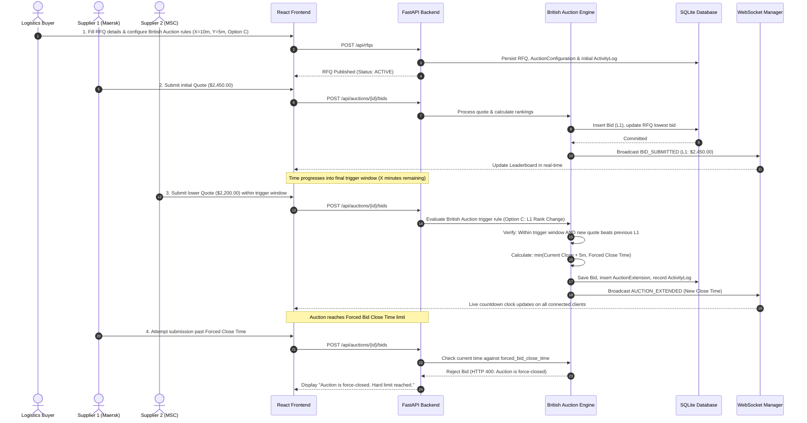

# High-Level Design (HLD) - British Auction RFQ Management System

## 1. Executive Overview

The **British Auction RFQ Management System** is an enterprise-grade procurement and supplier bidding platform. It enables buyers to publish Request for Quotations (RFQs) with configurable dynamic auction rules, allows multiple pre-qualified suppliers to submit competitive sealed quotes in real-time, automatically evaluates anti-sniping extension conditions, and enforces hard forced-close limits.

---

## 2. System Architecture

The application adopts a decoupled client-server architecture consisting of a **React + Vite** single-page frontend, a **Python FastAPI** backend service, and an embedded **SQLite** relational database managed via **SQLAlchemy ORM**.

```mermaid
flowchart TD
    subgraph ClientLayer["Frontend Layer (React 19 + Vite)"]
        UI["Web Browser Client (HTML5 / CSS3 / Inter Font)"]
        Router["React Router DOM (Protected Routes)"]
        AxiosClient["Axios REST API Client"]
        WSClient["HTML5 WebSocket Client"]
    end

    subgraph APILayer["Backend Layer (FastAPI + Python 3.12)"]
        FastAPIServer["FastAPI Application Server (Uvicorn)"]
        AuthMiddleware["JWT Authentication & RBAC (Admin / Buyer / Supplier)"]
        RESTEndpoints["REST API Endpoints (/api/rfqs, /api/auctions, /api/bids)"]
        WSManager["WebSocket Connection Manager (/ws/auctions/{id})"]
        AuctionEngine["British Auction & Ranking Engine"]
    end

    subgraph DataLayer["Persistence Layer (SQLite + SQLAlchemy 2.0)"]
        ORM["SQLAlchemy ORM (Models & Relationships)"]
        SQLiteDB[("SQLite Relational Database (auction.db)")]
    end

    UI --> Router
    Router --> AxiosClient
    Router --> WSClient

    AxiosClient -- "HTTP Requests (JSON, JWT Bearer)" --> RESTEndpoints
    WSClient <--> "Bi-directional Live Events" <--> WSManager

    RESTEndpoints --> AuthMiddleware
    AuthMiddleware --> AuctionEngine
    AuctionEngine --> WSManager
    AuctionEngine --> ORM
    ORM <--> SQLiteDB
```

---

## 3. Communication Patterns

### A. Synchronous REST API Communication
- **Protocol**: HTTP/1.1 over TCP with TLS support.
- **Data Format**: Standard JSON payload serialization using Pydantic v2 schemas.
- **Authentication**: Stateless JSON Web Tokens (JWT) passed via `Authorization: Bearer <token>` HTTP request headers.
- **Key Operations**:
  - `POST /api/auth/login`: User and supplier account authentication.
  - `POST /api/rfqs`: RFQ creation with British Auction rule configuration.
  - `GET /api/auctions`: Real-time auction status, countdown metrics, and listings.
  - `GET /api/auctions/{id}`: Detailed auction view including supplier leaderboard, quote history, and audit timeline.
  - `POST /api/auctions/{id}/bids`: Competitive quote submission processed through the auction rules engine.

### B. Asynchronous WebSocket Real-Time Communication
- **Protocol**: Persistent WebSocket connection (`ws://` / `wss://`).
- **Endpoint**: `/ws/auctions/{rfq_id}` and `/ws/dashboard`.
- **Purpose**: Sub-second propagation of bidding activity without client polling.
- **Broadcast Events**:
  - `BID_SUBMITTED`: Dispatched when any supplier places a valid quote. Contains updated ranking leaderboard and price to beat.
  - `AUCTION_EXTENDED`: Dispatched when a quote meets the trigger condition within the trigger window ($X$ minutes), notifying all clients of the newly extended closing time.
  - `DASHBOARD_UPDATE`: Propagates aggregate auction metrics to the global dashboard.

---

## 4. End-to-End Business Workflow

The system follows a strict state transition lifecycle from initial procurement creation to final auction closing:



---

## 5. Core Architectural Components

### 1. Frontend Client Application (React 19 + Vite)
- Built with modular functional components, React Hooks (`useState`, `useEffect`, `useContext`), and Tailwind CSS utility styling.
- Follows clean, professional procurement design system (white `#FFFFFF` background, `#111111` dark text, `#E5E5E5` borders, and unified Inter typography).
- Responsive layout including Left Sidebar Navigation, Breadcrumbs, Status Badges, Live Countdown Clocks, Supplier Leaderboard Tables, and Audit History.

### 2. FastAPI Application Server & Routers
- High-performance asynchronous Python web framework with native ASGI support (`uvicorn`).
- Divided into specialized API routers:
  - `auth`: User login, supplier registration, profile resolution, and JWT token issuance.
  - `rfq`: RFQ creation, drafting, searching, and status calculation.
  - `auction`: Auction listings, detailed auction state, rankings, and fast-forward evaluation helpers.
  - `bid`: Quote submission, validation, and supplier bid queries.
  - `activity`: Centralized system audit logs.

### 3. British Auction Engine & Ranking Service
- Encapsulates domain logic strictly on the backend:
  - **Single Best Supplier Rule**: Calculates L1, L2, L3 based on each distinct supplier's lowest total quote amount (freight + origin + destination charges).
  - **Tie-Breaking Rule**: Earlier submission timestamp wins ties.
  - **Competitive Quote Rule**: A supplier cannot submit a new quote unless it is strictly lower than their own previous best quote.
  - **Anti-Sniping Trigger Conditions**: Supports Option A (`ANY_BID`), Option B (`ANY_RANK_CHANGE`), and Option C (`L1_RANK_CHANGE`).
  - **Forced Close Ceiling**: New Close Time $= \min(\text{Current Close} + Y, \text{Forced Close})$. Under no circumstances can an auction extend beyond the hard ceiling.

### 4. Database Layer (SQLAlchemy 2.0 ORM + SQLite)
- Embedded SQLite relational database file (`auction.db`).
- Structured normalized schema with primary keys, indexed foreign keys, cascade delete constraints, and strict data type enforcement.
- Transactions managed via scoped sessions (`SessionLocal`).
